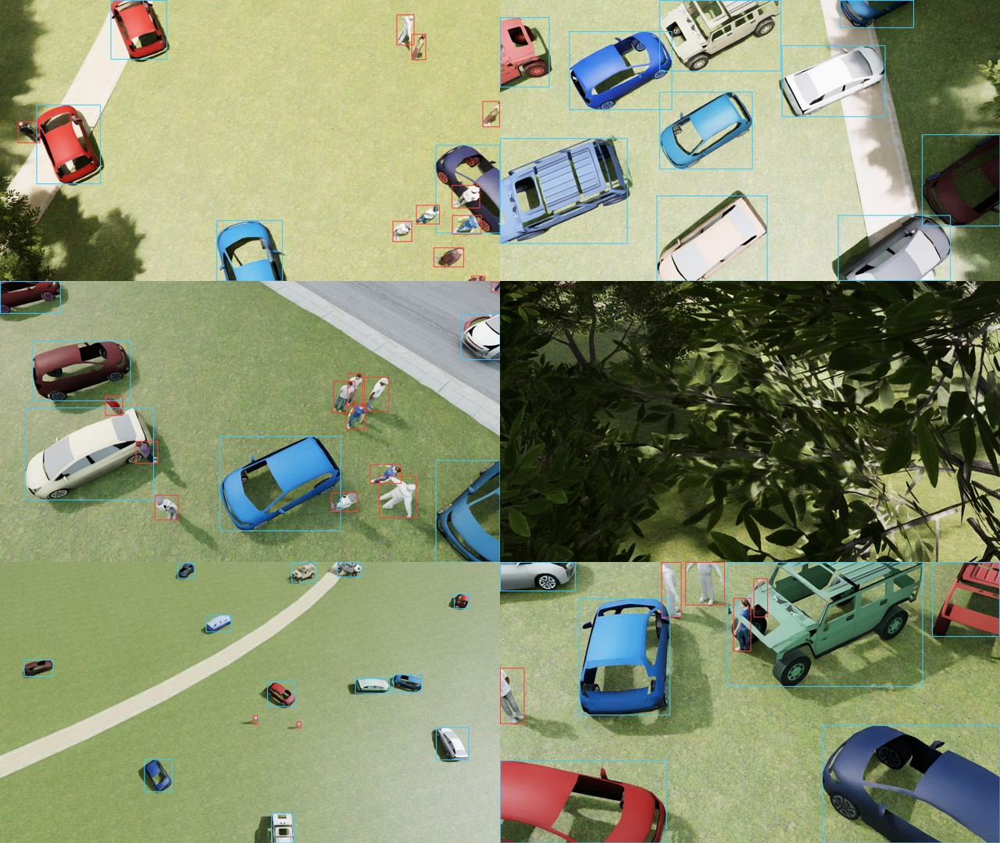
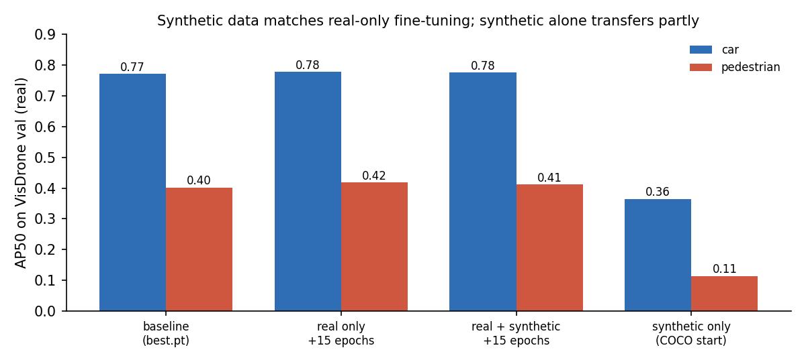
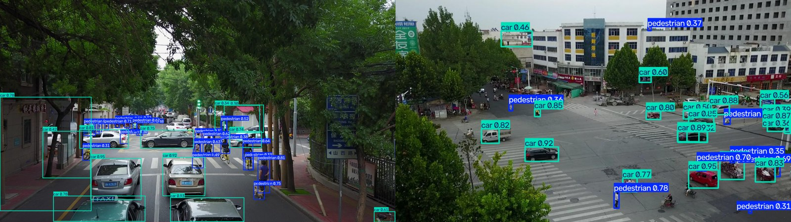

# Synthetic Aerial Data for UAV Detection (Isaac Sim Replicator)

Does adding simulator-rendered drone images to real training data improve a drone-view detector on **real** images?
This repo generates a labelled synthetic aerial dataset of cars and people with **NVIDIA Isaac Sim 6.0 Replicator**,
trains YOLOv8s variants with and without it, and scores every variant on the real **VisDrone2019-DET** validation set.



*Six of the 6,000 synthetic frames. Blue = car, red = pedestrian; every box comes from the renderer.*

## Results

All scores on the 548 real VisDrone validation images (YOLOv8s, 640 px).

| Model | Trained on | mAP50 | mAP50-95 | Car AP50 | Pedestrian AP50 |
|---|---|---|---|---|---|
| baseline | VisDrone (existing `best.pt`) | 0.378 | 0.221 | 0.771 | 0.401 |
| real_ft | baseline + 15 epochs VisDrone | 0.371 | 0.215 | 0.777 | 0.418 |
| real_syn | baseline + 15 epochs VisDrone + 6,000 synthetic | 0.372 | 0.215 | 0.775 | 0.411 |
| syn_only | COCO YOLOv8s + 30 epochs synthetic only | 0.048* | 0.029* | 0.364 | 0.114 |

\* syn_only only knows 2 of VisDrone's 10 classes; compare its car and pedestrian columns.



**Findings**

- **No measurable gain from synthetic data at this scale.** real_syn vs real_ft (identical schedule, the fair
  comparison) differ by 0.001 mAP50 and under 0.01 on any class, within single-run noise.
- **Partial sim-to-real transfer.** Trained only on rendered images, the detector finds real cars (AP50 0.36) and
  some pedestrians (0.11). It also labels unseen motorbikes and tricycles as cars.
- Likely reasons (untested): VisDrone already has 145k car / 79k pedestrian boxes, the park scene differs from dense
  city streets, and the synthetic frames contain no vans, buses or motorbikes. Natural next experiments: a 10 % real
  data subset, a city environment, more vehicle types.



*The synthetic-only model on real VisDrone validation images it never trained on.*

## How the generator works

`sdg/generate_aerial.py` loads the Baylands park (Gazebo Fuel, converted to USD), a pool of 18 cars (4 models) and
30 people (4 Gazebo Fuel + 7 Isaac Sim characters), and for every frame:

| Randomized | Range |
|---|---|
| Camera altitude above the viewed ground | 8 to 120 m (log-uniform) |
| Camera pitch below horizon / heading | 30 to 89 deg / any |
| Horizontal field of view | 55 to 95 deg, 1280x720 |
| Cars / people per frame | 0 to 18 / 0 to 30, people partly in groups of 2 to 6 |
| Car paint | real-traffic palette (85 %) or random colour |
| Sun | elevation 8 to 85 deg, any azimuth, 3000 to 7500 K, 25 % overcast |
| Ground | global tint on all park textures, random colour beyond the park edge |
| JPEG quality | 75 to 95 |

- **Visibility-aware placement:** objects are dropped where PhysX rays cast through random image pixels first hit park
  ground. Trees, roofs and props get in-memory colliders, so nothing is placed under a canopy or inside a building.
- **Labels:** Replicator's `bounding_box_2d_tight` annotator; boxes under 3 px or > 75 % occluded are dropped. Written as
  YOLO txt with VisDrone class ids (pedestrian 0, car 3) so the datasets mix directly.
- **Posing:** Isaac characters load in T-pose; `sdg/posing.py` authors a one-frame SkelAnimation that lowers the arms.
- About 4 frames/s on an RTX 4060 8 GB (`RaytracedLighting`, 4 subframes). 6,000 frames = 59.7k person and 40.4k car boxes, 1 GB.

## Reproduce

Tested on Ubuntu 22.04, Isaac Sim 6.0 (`~/isaacsim`), RTX 4060 8 GB, Python 3.10 venv with Ultralytics 8.4 / torch 2.5.

```bash
# 1. assets: Baylands + cars + people (Gazebo Fuel, converted to USD) and Isaac Sim characters
tools/fetch_assets.sh

# 2. real data: download VisDrone2019-DET train + val zips into ~/datasets/visdrone_raw, then
python tools/prepare_visdrone.py ~/datasets/visdrone_raw ~/datasets/VisDrone

# 3. synthetic data (Isaac Sim's Python)
~/isaacsim/python.sh sdg/generate_aerial.py --frames 6000 --out data/synthetic --seed 7
python tools/draw_labels.py data/synthetic preview.jpg 8          # always look at the labels

# 4. experiments (edit paths in train/data/*.yaml if your folders differ)
BASE_MODEL=path/to/visdrone_yolov8s.pt python train/run_experiments.py
python tools/make_figures.py
```

## Layout

| Path | Purpose |
|---|---|
| `sdg/generate_aerial.py` | Replicator generator (scene, camera, placement, lighting, labels) |
| `sdg/posing.py` | Relaxed arm pose for the Isaac Sim characters |
| `tools/fetch_assets.sh`, `tools/fetch_isaac_people.sh` | Download and convert all 3D assets |
| `tools/mesh_to_usd.py`, `tools/add_colliders.py` | OBJ/DAE to USD converter, Baylands ground colliders |
| `tools/prepare_visdrone.py` | VisDrone annotations to YOLO labels |
| `tools/draw_labels.py`, `tools/make_figures.py` | Label preview sheet, README figures |
| `train/run_experiments.py`, `train/data/*.yaml` | The four-model experiment |
| `results/metrics.{json,csv}` | Scores per model and class |

Generated data, datasets, model weights and downloaded assets are not in the repo (see `.gitignore`).

## Credits

- Baylands park, Hatchback, SUV, Prius Hybrid, Standing person, Casual female, Walking person, Rescue Randy:
  [Gazebo Fuel](https://app.gazebosim.org/OpenRobotics), OpenRobotics (see each model's licence).
- Character models: NVIDIA Isaac Sim 6.0 assets.
- [VisDrone2019-DET](https://github.com/VisDrone/VisDrone-Dataset), AISKYEYE team, Tianjin University.
- [Ultralytics YOLOv8](https://github.com/ultralytics/ultralytics).
- Companion project: [isaac-px4-uav-perception-testbed](https://github.com/amanullah7x/isaac-px4-uav-perception-testbed).
